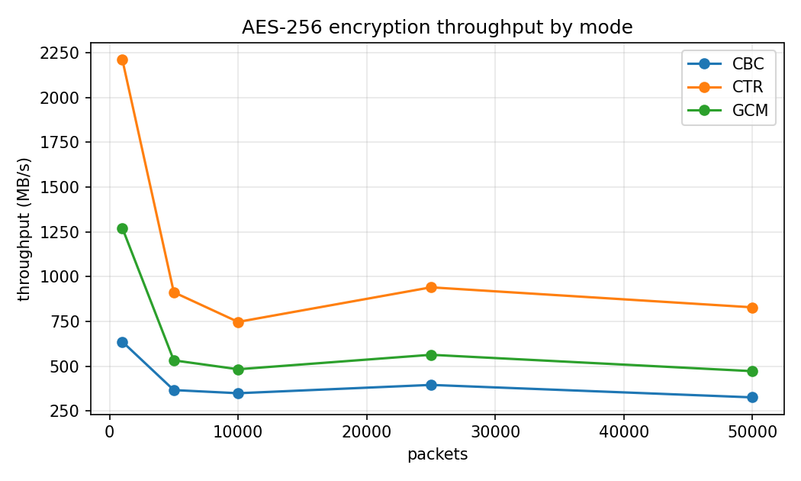
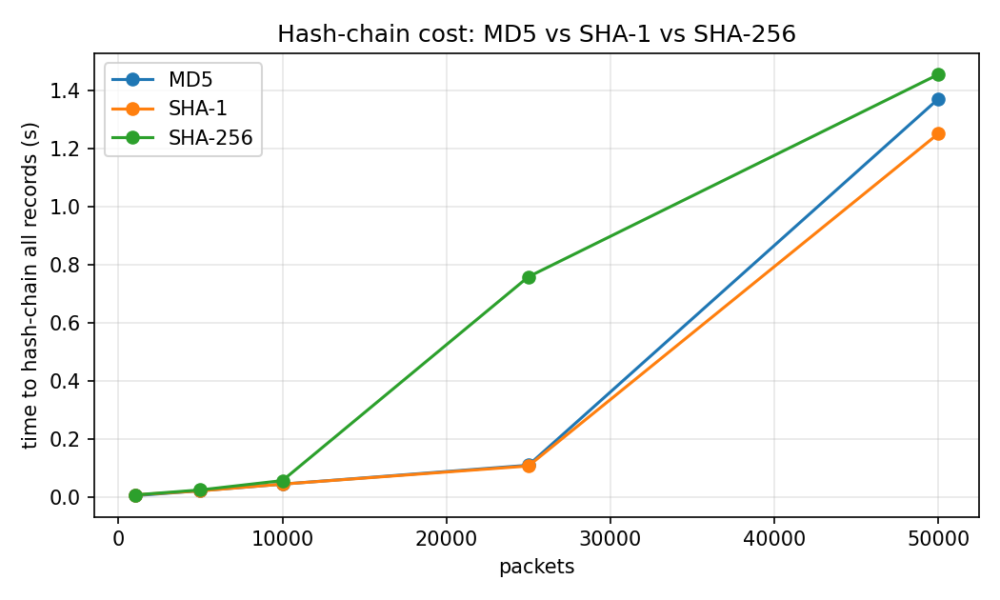
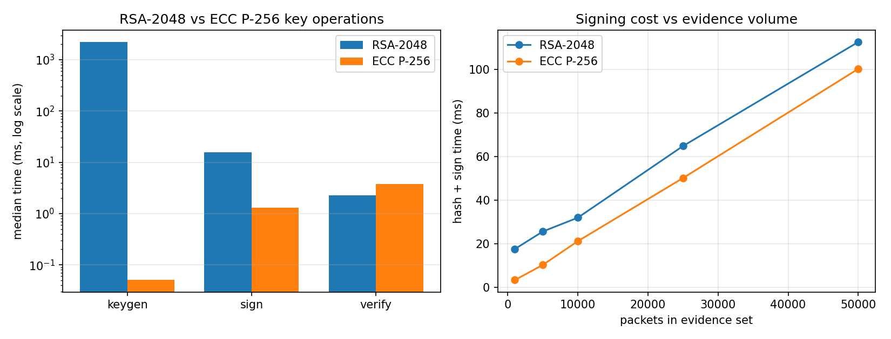

# PacketVault

**A tamper-evident network forensics store with cryptographic chain of custody.**

Information Security Lab mini project by Siddhant Shivam (13), Rohan Mathur (14) and Anvesha Gupta (15).

A raw `.pcap` file is easy to change. You can drop, inject or edit packets, and Wireshark will open the result without any warning. Hashing the whole file tells you *that* something changed, but not *what* changed. It also keeps nothing confidential and doesn't record who did the acquisition.

PacketVault turns a capture into a **sealed evidence bundle**:

| Layer | Technique | What it gives you |
|---|---|---|
| Integrity | SHA-256 rolling hash chain, `Hn = SHA256(Hn-1 ‖ record_n)` | Any modified, inserted or deleted packet is detected **and located by record index** |
| Confidentiality | AES-256-GCM, key from PBKDF2-HMAC-SHA256 (600k iterations, random per-case salt) | A stolen bundle gives up no readable data. The GCM tag detects ciphertext tampering |
| Authenticity | RSA-2048 PKCS#1 v1.5 signature over the case report | Anyone with the investigator's **public key** can confirm the evidence is intact and who sealed it (non-repudiation) |

---

## Quick start

```bash
pip install -r requirements.txt          # pycryptodome, matplotlib, pytest

python -m packetvault sample  samples/lab.pcap                 # synthetic lab capture + ground truth
python -m packetvault keygen  --out-dir keys                    # investigator RSA-2048 keypair
python -m packetvault seal    samples/lab.pcap --out cases/CASE-001 \
       --key keys/investigator_private.pem --investigator "Anvesha Gupta" --case-id CASE-001
python -m packetvault verify  cases/CASE-001 --pubkey keys/investigator_public.pem
```

To run the full guided demo (seal, verify, tamper, verify again, detect):

```bash
powershell -ExecutionPolicy Bypass -File scripts/demo.ps1      # Windows
bash scripts/demo.sh                                           # Linux / macOS
```

The passphrase is read from an interactive prompt, from the `PACKETVAULT_PASSPHRASE` environment variable, or from `--passphrase`.

### Example: catching a single-packet edit

```text
$ packetvault tamper cases/CASE-001 --mode modify --index 1500
ATTACK: changed dst_port of frame #1500: 351 -> 4444 (container re-encrypted with the correct passphrase)

$ packetvault verify cases/CASE-001 --pubkey keys/investigator_public.pem
  [PASS] RSA signature     report.json signed by key 4d:0f:a1:69:43:76:c7:9e:...
  [FAIL] Container digest  SHA-256 7fc351dfe900fb6c... != signed c7e81f61f51b762f...
  [PASS] AES-GCM tag       container decrypted and authenticated
  [FAIL] Hash chain        hash chain diverges at position 1500 (frame #1500) ...

  >> tampering localised to record position 1500 (frame #1500)

VERDICT: FAIL
```

---

## Commands

| Command | Module | Purpose |
|---|---|---|
| `sample <out.pcap>` | – | Generate a deterministic lab capture (benign traffic, an Nmap `-sS` scan, a slow `-sT` scan) with ground-truth labels |
| `keygen` | M5 | Create an RSA-2048 investigator keypair (`--protect` encrypts the private key) |
| `parse <pcap>` | M1 | Parse into an XML interchange document and an indexed SQLite DB (unsealed) |
| `seal <pcap>` | M1–M5 | Parse, hash-chain, encrypt, detect, report and sign, producing a case bundle |
| `verify <case>` | M6 | Check the signature, container digest, GCM tag and hash chain. Exit code 0 means PASS, 2 means FAIL |
| `tamper <case>` | – | Simulate an attack (`modify`, `delete`, `insert`, `recompute`, `bitflip`) for demonstrations |
| `detect <pcap\|case>` | M4 | Port-scan detection. Add `--labels` to get precision and recall |
| `query <case>` | – | Filter packets by IP, port, protocol or flags inside the encrypted store |
| `export <case>` | M1 | Export the sealed packets back to XML |
| `bench <pcap\|case>` | M7 | Benchmark AES modes, hash functions, and RSA vs ECC, and write plots |

## Bundle format

```
cases/CASE-001/
├── evidence.db.enc   PVLT container: header(magic, version, cipher, iterations, salt, nonce) ‖ AES-256-GCM(SQLite) ‖ tag
├── report.json       signed case report: acquisition metadata, H0, root hash, checkpoints,
│                     container SHA-256, traffic statistics, detection alerts, signer fingerprint
├── report.sig        detached RSA-2048 PKCS#1 v1.5 signature over report.json
└── report.txt        human-readable report (report.pdf as well if ReportLab is installed)
```

The 38-byte container header is authenticated as GCM associated data, so changing the salt, nonce or iteration count is caught too. The plaintext SQLite database is built and checked **only in memory** (`sqlite3.serialize`/`deserialize`). Only ciphertext is ever written to disk.

## How verification works

```
public key ──► 1. RSA signature over report.json        ─┐  needs only the public key:
               2. SHA-256(evidence.db.enc) == signed     ─┘  any third party can run these
passphrase ──► 3. AES-GCM tag authenticates container
               4. Recompute H0 from the *signed* acquisition metadata, then every Hn:
                  · first stored ≠ recomputed hash   → exact record position
                  · recomputed root ≠ signed root    → chain was rebuilt by an insider
                  · signed checkpoints (every 256)   → locate the rebuilt section to a 256-record window
                  · record count ≠ signed count      → insertion / deletion
```

| Attack (`tamper --mode`) | Caught by | Localised to |
|---|---|---|
| `modify`: edit one field, keep stored hashes | container digest + hash chain | exact record |
| `delete`: remove a record, renumber the rest | container digest + chain + count | exact record |
| `insert`: inject a forged packet | container digest + chain + count | exact record |
| `recompute`: edit and rebuild every later hash | container digest + signed root | 256-record checkpoint window |
| `bitflip`: change ciphertext without the key | container digest + GCM tag | n/a (cannot decrypt) |
| edit `report.json` | RSA signature | n/a |

## Port-scan detection (M4)

A source host is flagged when it sends connection-initiating probes (TCP SYN without ACK, or UDP from an ephemeral port) to **more than 15 distinct destination ports inside any 10 s sliding window**. The **SYN : SYN-ACK ratio** is the corroborating signal. Legitimate clients finish their handshakes (ratio ≈ 1), while scanners mostly get RSTs back. When both signals fire, the alert is rated HIGH.

Results on the bundled lab capture (`samples/lab_capture.pcap`, 3,548 packets, 8 hosts):

| Host | Behaviour | Max ports / 10 s | SYN:SYN-ACK | Result |
|---|---|---|---|---|
| 192.168.56.101 | Nmap `-sS -p1-1024` | 1024 | 1024 : 3 | **HIGH**, true positive |
| 192.168.56.102 | Nmap `-sT -T2`, 60 ports over 30 s | 21 | 60 : 3 | **HIGH**, true positive |
| 192.168.56.23 | crawler, 40 connections to ports 80/443 | 2 | ≈ 1 | not flagged, true negative |
| 192.168.56.10 | busy server (replies to many ephemeral ports) | 0 probes | – | not flagged, true negative |

The detector scores precision 1.0, recall 1.0 and F1 1.0. With `--threshold 50` it misses the slow scan, which shows the window and threshold trade-off.

## Benchmarks (M7)

`packetvault bench samples/lab_capture.pcap --out-dir results` runs these over 1k to 50k packet records. Numbers below are from a typical laptop (Python 3.13, PyCryptodome 3.23). Raw data is in [`docs/benchmarks/benchmarks.json`](docs/benchmarks/benchmarks.json).

| AES-256 mode | Throughput (50k packets) | Integrity |
|---|---|---|
| CTR | ~830 MB/s | none |
| **GCM** | ~470 MB/s | **built-in authentication tag** |
| CBC | ~330 MB/s | none (and needs padding) |

| Hash (chain workload) | µs / record |
|---|---|
| MD5 | 27.4 (broken, collisions) |
| SHA-1 | 25.0 (broken, SHAttered 2017) |
| **SHA-256** | **29.1**, only about 6–16 % slower, collision-resistant |

| | Key generation | Sign | Verify |
|---|---|---|---|
| RSA-2048 | ~2,200 ms | 15.9 ms | **2.3 ms** |
| ECC P-256 | ~0.1 ms | 1.3 ms | 3.8 ms |

These results back the design choices. GCM costs about 40 % of CTR's throughput but adds authenticated encryption, so no separate MAC is needed. SHA-256 costs almost nothing more per packet than the broken hashes. RSA verification is faster than ECDSA, which suits a design where a report is signed once and verified many times by third parties. ECC would be the better choice where key generation or signing is frequent.

<p align="center">
  
  
  
</p>

## Project layout

```
packetvault/
├── models.py        PacketRecord + canonical serialisation (input to every hash)
├── pcapio.py        dependency-free PCAP/PCAPNG reader (Ethernet, SLL, raw IP; IPv4/6, TCP, UDP, ICMP, ARP)
├── parser.py        M1: pyshark / builtin backends, XML + SQLite store
├── chain.py         M2: SHA-256 rolling hash chain, checkpoints, divergence localisation
├── vault_crypto.py  M3: PBKDF2 + AES-256-GCM container (CBC/CTR for comparison)
├── detect.py        M4: sliding-window port-scan heuristic + evaluation
├── report.py        M5: statistics, report rendering (txt / pdf)
├── signing.py       M5/M6: RSA-2048 keys, PKCS#1 v1.5 sign / verify
├── bundle.py        seal pipeline that ties M1–M5 together
├── verify.py        M6: layered verification
├── tamper.py        attack simulator for demos and tests
├── bench.py         M7: benchmarks and plots
├── samplegen.py     deterministic synthetic lab traffic with ground truth
└── cli.py           command-line interface
tests/               45 pytest tests: parser, chain, crypto, detection, end-to-end tamper scenarios
```

## Parsing backends

`--backend auto` (the default) uses **Pyshark/tshark** when Wireshark is installed and falls back to the built-in pure-Python decoder otherwise. Both produce the same normalised record (frame number, timestamp, MACs, IPs, protocol, ports, TCP flags, frame and payload length). The test suite uses the built-in backend, so it runs anywhere with no Wireshark install.

```bash
pip install pyshark          # plus Wireshark/tshark on PATH
pip install reportlab        # optional PDF case report
```

## Running tests

```bash
pytest -q
```

## Status (mid-term check)

- [x] M1 Packet parser (builtin PCAP/PCAPNG decoder, Pyshark backend, XML + indexed SQLite)
- [x] M2 SHA-256 hash chain with exact-record localisation and signed checkpoints
- [x] M3 AES-256-GCM container with PBKDF2 key derivation and authenticated header
- [x] M4 Port-scan heuristic with SYN:SYN-ACK corroboration and ground-truth evaluation
- [x] M5 Signed case report (JSON + text, PDF via ReportLab)
- [x] M6 Standalone verifier with PASS/FAIL per layer
- [x] M7 Benchmark suite with three plots
- [ ] Capture real Nmap traffic in the VirtualBox lab (Kali attacker → Ubuntu target, host-only network) and re-run the detection evaluation on it
- [ ] Validate the Pyshark backend against tshark on the lab captures
- [ ] Final report and presentation
