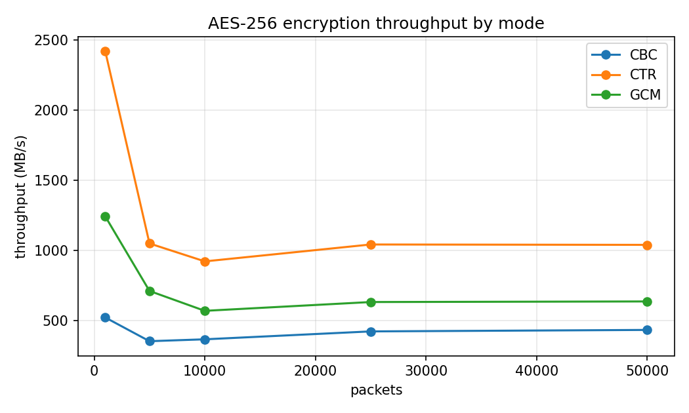
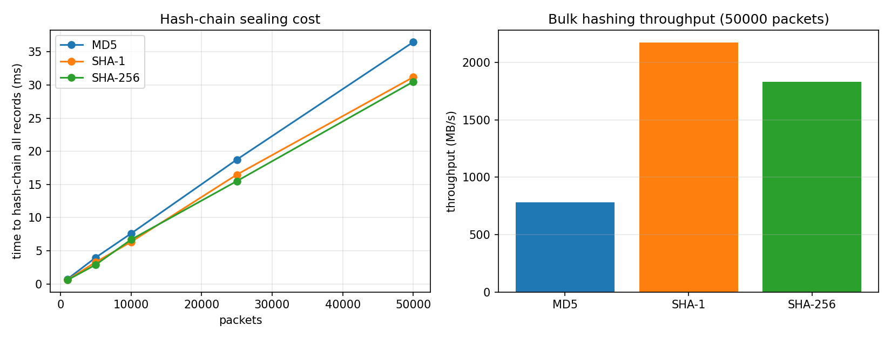
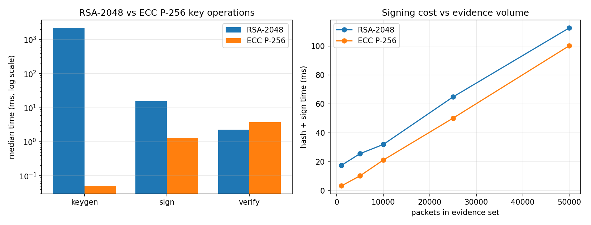

# PacketVault

**A tamper-evident network forensics store with searchable encryption and a cryptographic chain of custody.**

Information Security Lab mini project by **Siddhant Shivam (13)**, **Rohan Mathur (14)** and **Anvesha Gupta (15)**.

PacketVault takes a packet capture (a `.pcap` file from Wireshark), turns every packet into a structured record and **seals** the result into an evidence bundle. The bundle is:

- **tamper-evident**: any change to any packet is detected *and* pinpointed to the exact packet,
- **confidential**: the packets are encrypted, so a stolen bundle reveals nothing,
- **searchable**: you can search it without decrypting everything, and the storage never sees what you searched for,
- **attributable**: it is digitally signed, so anyone can check who sealed it and that it hasn't changed since.

---

## Contents

1. [The problem in one minute](#1-the-problem-in-one-minute)
2. [The idea: a sealed evidence bag](#2-the-idea-a-sealed-evidence-bag)
3. [Quick start](#3-quick-start)
4. [How it works, step by step (modules M1–M7)](#4-how-it-works-step-by-step)
5. [Attacks and how each one is caught](#5-attacks-and-how-each-one-is-caught)
6. [Results](#6-results)
7. [The web dashboard](#7-the-web-dashboard)
8. [How this matches the synopsis](#8-how-this-matches-the-synopsis)
9. [Presenting it: a 5-minute demo and likely questions](#9-presenting-it)
10. [Limitations and known issues](#10-limitations-and-known-issues)
11. [Reference: commands, bundle format, code layout](#11-reference)
12. [Glossary](#12-glossary)

---

## 1. The problem in one minute

When a network is attacked, the packet capture (PCAP) is the main **evidence**: it records every packet that crossed the wire. But a `.pcap` file has three weaknesses:

| Weakness | Why it matters |
|---|---|
| **Anyone can edit it** | Packets can be deleted, inserted or changed. Wireshark opens the edited file without any warning. Evidence that can be silently changed is worthless in an investigation or in court. |
| **Hashing the whole file is too coarse** | The usual practice is to record one SHA-256 hash of the file. If the hash changes you know *something* changed, but not *which* packet, so you can't tell a corrupted byte from a forged attack packet. |
| **No confidentiality, no proof of who collected it** | A stolen capture leaks everything: IPs, passwords in clear-text protocols, internal network layout. And nothing in the file says who acquired it. |

**PacketVault fixes all three**, using the techniques from our lab exercises: hashing (Lab 5), symmetric encryption and key derivation (Lab 2) and digital signatures (Labs 3, 6).

---

## 2. The idea: a sealed evidence bag

Think of how police handle physical evidence. They put it in a bag, seal it with **tamper-evident tape**, and **sign and date** the label. If anyone opens the bag, the tape shows it. PacketVault does the same for network evidence, with cryptography instead of tape:

```
                         ┌──────────────────────── PacketVault "seal" ─────────────────────────┐
                         │                                                                      │
  capture.pcap  ──►  M1 parse  ──►  M2 hash chain  ──►  M3 encrypt  ──►  M4 detect  ──►  M5 sign │
  (from Wireshark)   every packet   links every        AES-256-GCM      port-scan        RSA-2048 │
                     → a record     packet to the      + blind index    alerts           signature│
                                    one before it      for search                                 │
                         └──────────────────────────────────────┬───────────────────────────────┘
                                                                ▼
                                          cases/CASE-001/   (the sealed bundle)
                                            evidence.db.enc   encrypted packet database
                                            search.idx        encrypted search index
                                            report.json       case report (hashes, alerts, metadata)
                                            report.sig        RSA signature over report.json
                                            report.txt        human-readable report

  Later, anyone:   M6 verify  ──►  PASS, or FAIL + "tampering at packet #1500"
```

| Security goal | What we use | What it gives |
|---|---|---|
| **Integrity** | SHA-256 rolling **hash chain**: `Hn = SHA256(Hn-1 ‖ record_n)` | Any modified, inserted or deleted packet is detected **and located by its number** |
| **Confidentiality** | **AES-256-GCM**, key derived from a passphrase with **PBKDF2-HMAC-SHA256** (600,000 iterations, random salt) | A stolen bundle reveals nothing; the GCM tag also detects any change to the ciphertext |
| **Searchable encryption** | **Blind index**: keyed HMAC-SHA256 search tokens and per-record AES-GCM | The storage can answer "packets from 192.168.56.101" while seeing only random-looking tokens |
| **Authenticity / non-repudiation** | **RSA-2048** digital signature (PKCS#1 v1.5, SHA-256) over the report | Anyone with the investigator's **public key** can confirm who sealed the evidence and that it is unchanged |

---

## 3. Quick start

Requires Python 3.11 or newer.

```bash
pip install -r requirements.txt      # pycryptodome, matplotlib, pytest

python -m packetvault sample  samples/lab.pcap                  # make a lab capture with 2 port scans in it
python -m packetvault keygen  --out-dir keys                     # investigator's RSA-2048 key pair
python -m packetvault seal    samples/lab.pcap --out cases/CASE-001 \
       --key keys/investigator_private.pem --investigator "Anvesha Gupta" --case-id CASE-001
python -m packetvault verify  cases/CASE-001 --pubkey keys/investigator_public.pem
python -m packetvault query   cases/CASE-001 --src 192.168.56.101 --flags SYN --show-tokens
```

You'll be asked for a **case passphrase**. It can also come from the `PACKETVAULT_PASSPHRASE` environment variable or `--passphrase`.

**The full guided demo** (seal → verify → search → six different attacks → verify each → detection):

```bash
powershell -ExecutionPolicy Bypass -File scripts/demo.ps1      # Windows
bash scripts/demo.sh                                           # Linux / macOS / Git Bash
```

**The web dashboard** (everything above with buttons, charts and Nmap / Wireshark integration):

```bash
python -m packetvault ui        # opens http://127.0.0.1:8765/
```

**The tests** (89 automated tests):

```bash
python -m pytest -q
```

---

## 4. How it works, step by step

We follow one capture through the whole system. The sample capture `samples/lab_capture.pcap` has **3,548 packets** from a small lab network (`192.168.56.0/24`) with 8 hosts: a web server, a DNS server, three normal clients, a web crawler, and **two attackers running port scans**.

### M1 — Packet Parser (`parser.py`, `pcapio.py`, `models.py`)

**What it does.** Reads the PCAP or PCAPNG file and turns each packet into one **normalised record** with the same 12 fields. Here is packet #1500 of the sample, one of the attacker's scan probes:

```
index=1500  timestamp=1759800041.899025
src_mac=08:00:27:00:38:65   dst_mac=08:00:27:00:38:0a
src_ip=192.168.56.101       dst_ip=192.168.56.10      protocol=TCP
src_port=43379              dst_port=351              tcp_flags=SYN
frame_len=54                payload_len=0
```

The records are saved as **XML** (for exchanging with other tools) and as an **indexed SQLite database** (for fast searching, indexed on timestamp and IP pair).

**Two parsing backends.** As the synopsis proposes, it can use **Pyshark** (Wireshark's `tshark` engine). It also has its own **pure-Python decoder**, so it works on any machine, even without Wireshark installed. The dashboard can cross-check the two, field by field.

**Canonical form.** Before hashing, each record is turned into one exact byte string (fixed field order, no spaces), e.g.
`[1500,"1759800041.899025","08:00:27:00:38:65",...,"SYN",54,0]`.
This matters because a hash changes if even one space changes. Every computer must produce exactly the same bytes for the same packet.

### M2 — Integrity Sealing Engine: the hash chain (`chain.py`)

**The concept.** A **hash function** (SHA-256) turns any data into a fixed 32-byte "fingerprint". Change one bit of the input and the fingerprint changes completely, and it's infeasible to find two inputs with the same fingerprint.

**What we do.** Instead of one hash for the whole file, we build a **chain**. Each packet's hash includes the previous packet's hash:

```
H0 = SHA256("PacketVault/v1/H0" ‖ acquisition metadata)     ← case ID, investigator, time, source file's SHA-256 …
H1 = SHA256(H0 ‖ record 1)
H2 = SHA256(H1 ‖ record 2)
 …
Hn = SHA256(Hn-1 ‖ record n)        ← the last one, H3548, is the "root hash"
```

**Why a chain localises tampering.** If someone changes packet 1500, its hash `H1500` no longer matches. Because every later hash depends on it, `H1501 … H3548` break too. The verifier walks the chain from the start and reports **the first position where the recomputed hash differs from the stored one**. That position is exactly the tampered packet.

```
stored:      H1 ✓  H2 ✓  …  H1499 ✓  H1500 ✗  H1501 ✗  …  H3548 ✗
                                       ▲
                          first mismatch = the edited packet
```

A chain also protects **order and completeness**. Deleting, inserting or swapping packets breaks it too. Separate per-packet hashes wouldn't catch that.

**Two extra safeguards:**
- **H0 is built from the acquisition metadata**, including the original file's SHA-256, so the chain is tied to *this* case and *this* source file.
- **Checkpoints.** The hash at every 256th packet is copied into the signed report. This matters for the "smart attacker" in [section 5](#5-attacks-and-how-each-one-is-caught).

### M3 — Confidentiality Layer (`vault_crypto.py`)

**Step 1: turn a passphrase into a key (PBKDF2).** People choose passphrases, but AES needs a random-looking 256-bit key. **PBKDF2-HMAC-SHA256** derives one by hashing the passphrase **600,000 times** with a **random salt**:
- **600,000 iterations** make every passphrase guess slow, about 0.3 s, so brute-forcing is very expensive (this follows OWASP's 2023 guidance).
- **The random salt** (16 bytes, new for every case) means the same passphrase gives a different key for every case, so pre-computed guess tables are useless.

**Step 2: encrypt with AES-256-GCM.** **AES** is the standard block cipher. **GCM** is a mode of operation that gives **authenticated encryption**: as well as encrypting, it computes a 16-byte **authentication tag**. If even one bit of the ciphertext changes, decryption refuses with an error instead of returning garbage. CBC and CTR, the other modes in the benchmarks, give no such protection.

**The container file** `evidence.db.enc`:

```
offset  size  field
0       4     magic "PVLT"
4       1     format version
5       1     cipher id (1 = AES-256-GCM)
6       4     PBKDF2 iteration count
10      16    salt                      ← random per case
26      12    GCM nonce                 ← random per encryption
38      n     ciphertext (the SQLite database)
38+n    16    GCM authentication tag
```

The 38-byte header is fed into GCM as **associated data**, so changing the salt, nonce or iteration count is caught as well. The plaintext database is **only ever built in memory**. No unencrypted copy is ever written to disk.

### M3 — Searchable encryption: the blind index (`search.py`)

**The problem.** With normal encryption, answering "show me the packets from 192.168.56.101" means decrypting *everything*. So whoever stores the evidence must hold the key, or must send you the whole file.

**The idea.** We split the work between two parties:
- **The store** (e.g. a server or cloud bucket) holds `search.idx` and **no key**.
- **The investigator's client** holds the passphrase.

```
   investigator (has key)                                  store (no key)
   ──────────────────────                                  ──────────────
   "src_ip = 192.168.56.101"
        │  token = HMAC-SHA256(k_tok, "src_ip" ‖ value)
        ▼
   61ea4b80d09fba087b03d1014f94622b  ───── token ─────►   looks up the token in its table:
                                                           token → [822, 829, 834, …]
   decrypts only those records    ◄── 1024 ciphertexts ──  returns those encrypted records
```

- **A token** is a keyed hash (HMAC) of a field name plus value. Without the key you can't compute the token for an IP, so the store can't test guesses.
- **Every record is encrypted on its own** with AES-256-GCM, so only the matches need decrypting.
- **Each ciphertext is bound to its case and position** (through GCM's associated data), so the store can't swap in records from another case or reorder them.
- **The index file's SHA-256 is in the signed report.** If the store deletes tokens to hide a packet from searches, verification catches it.

**What the store still learns** (be ready to say this; no practical searchable encryption is perfect):
- **which records share a value**, and so how often each value occurs (e.g. "the most common destination port is probably 443"),
- **which records matched a query**, and whether two queries were the same.

It never learns an IP, a port, a query or a packet's contents. Only exact-match searches are supported. Ranges like time windows would need weaker schemes.

### M4 — Detection Module: port-scan heuristic (`detect.py`)

A **port scan** (e.g. Nmap) is how attackers map a network: they knock on many ports to see which are open. The detector uses two signals.

1. **Main rule.** Flag a source host that sends connection-opening probes (TCP SYN without ACK, or UDP from a high port) to **more than 15 different destination ports within any 10-second sliding window**. A normal client talks to a few ports; a scanner touches hundreds.
2. **Confirming signal: the SYN : SYN-ACK ratio.** A normal client completes most TCP handshakes (ratio ≈ 1). A scanner mostly hits closed ports and gets resets, not SYN-ACKs, so its ratio is very high. When both signals fire, the alert is rated **HIGH**.

Only *probes* are counted, not replies. So a busy server answering many clients on many ports isn't mistaken for a scanner.

### M5 — Report Generation and Signing (`report.py`, `signing.py`, `bundle.py`)

The case report `report.json` contains:
- the acquisition metadata (case ID, investigator, time, source file name, size and SHA-256),
- the chain values: H0, the root hash and the checkpoints,
- the SHA-256 of the encrypted container and of the search index,
- traffic statistics and the detection alerts.

It's then **digitally signed** with the investigator's **RSA-2048 private key** (PKCS#1 v1.5 over SHA-256). The signature goes in `report.sig`.

**What a digital signature proves.** Only the holder of the private key can produce a signature that verifies under the matching **public key**. So a valid signature proves:
- **who** sealed the case (authenticity, and non-repudiation: they can't later deny it),
- that the report **hasn't changed by a single byte** since.

The report holds the hash of *everything else*, so signing this one small file protects the whole bundle.

### M6 — Verification Utility (`verify.py`)

`packetvault verify` checks every layer in order of trust:

```
public key ──► 1. RSA signature over report.json         ─┐
               2. SHA-256(evidence.db.enc) == signed      │  need only the public key:
               3. SHA-256(search.idx) == signed           ─┘  ANY third party can run these
passphrase ──► 4. AES-GCM tag: container decrypts and authenticates
               5. Hash chain: rebuild H0 from the *signed* metadata, recompute every Hn
                  · first stored ≠ recomputed hash → exact packet number
                  · recomputed root ≠ signed root  → the chain was rebuilt by an insider
                  · signed checkpoints             → narrow a rebuilt chain to a 256-packet window
                  · count ≠ signed count           → packets inserted or deleted
               6. Index consistency: every index record matches the container's record
```

On an untouched case, every check passes (real output):

```text
$ packetvault verify demo/case-001 --pubkey demo/keys/investigator_public.pem
  [PASS] RSA signature     report.json signed by key 2b:16:eb:6f:86:6c:3a:4d:3a:b4:b7:86:e7:57:96:20
  [PASS] Container digest  SHA-256 676aa74789b3f219... matches signed report
  [PASS] Search index      SHA-256 ff226deb7f406f92... matches signed report (21108 tokens)
  [PASS] AES-GCM tag       container decrypted and authenticated
  [PASS] Hash chain        3548 records, root e803c116e467cc9a... matches
  [PASS] Index consistency all 3548 index records and tokens match the container

VERDICT: PASS
```

Exit code 0 means PASS and 2 means FAIL, so scripts can use it. `--public-only` runs only checks 1–3, for someone who has the public key but not the passphrase.

### M7 — Benchmarking Suite (`bench.py`)

This measures the alternatives so the design choices rest on **numbers, not opinion**:
- AES-CBC vs CTR vs GCM throughput,
- MD5 vs SHA-1 vs SHA-256 cost,
- RSA-2048 vs ECC P-256 key generation, signing and verification,

each over 1k–50k packet records, with plots. The results are in [section 6](#6-results).

### Extra — Nested MAC custodian key (`nmac.py`, optional)

**The gap.** The hash chain uses no key. An insider who knows the passphrase can edit a packet and **recompute every later hash**. The signed root still catches it, but only to a 256-packet window.

**The fix.** A separate **custodian key** (held by the evidence custodian, not by the analysts) adds a keyed tag to every chain link:

`Tn = SHA256(k2 ‖ SHA256(k1 ‖ n ‖ Hn))`

This is a **Nested MAC** (NMAC). The insider can't forge these tags, so the edit is pinpointed exactly.

**Why nested, and not just `SHA256(key ‖ message)`?** The simple version is broken by a **length-extension attack**. `nmac.py` contains a pure-Python SHA-256 that performs this forgery live: it succeeds against the simple MAC and fails against NMAC. HMAC, the standard MAC, is built on the same nested idea.

```bash
python -m packetvault keygen --out-dir keys --custodian
python -m packetvault seal ... --custodian-key keys/custodian.key
python -m packetvault verify ... --custodian-key keys/custodian.key
```

---

## 5. Attacks and how each one is caught

The `tamper` command simulates attacks so you can show the detection working. The dashboard's Security tab runs all of them automatically on throw-away copies.

| Attack | Who could do it | Caught by | Pinpointed to |
|---|---|---|---|
| `modify`: change one field of one packet | insider with the passphrase | container hash, hash chain | **exact packet** |
| `delete`: remove a packet | insider | container hash, chain, packet count | **exact packet** |
| `insert`: inject a forged packet | insider | container hash, chain, packet count | **exact packet** |
| `recompute`: change a packet *and* rebuild every later hash | smart insider | container hash, **signed root hash**, index consistency | 256-packet window by checkpoints; **exact** with the index or custodian key |
| `bitflip`: change the encrypted file without the key | outsider | container hash, **AES-GCM tag** | n/a (it can't be decrypted) |
| `unindex`: storage deletes a packet's search tokens to hide it | storage provider (no key) | **search index hash** (public check) | n/a; searches refuse the index |
| edit `report.json` (e.g. change the investigator's name) | anyone | **RSA signature** | n/a |
| re-sign the report with the attacker's own key | anyone | **RSA signature** (wrong key) | n/a |
| open with a wrong passphrase | outsider | **AES-GCM tag** / key check | n/a |

**Example 1: an insider changes one port number in packet 1500** (real output):

```text
$ packetvault tamper demo/case-tampered --mode modify --index 1500
ATTACK: changed dst_port of frame #1500: 351 -> 4444 (container re-encrypted with the correct passphrase)

$ packetvault verify demo/case-tampered --pubkey demo/keys/investigator_public.pem
  [PASS] RSA signature     report.json signed by key 2b:16:eb:6f:86:6c:3a:4d:3a:b4:b7:86:e7:57:96:20
  [FAIL] Container digest  SHA-256 db05102cf0acc860... != signed 676aa74789b3f219... (container replaced or modified)
  [PASS] Search index      SHA-256 ff226deb7f406f92... matches signed report (21108 tokens)
  [PASS] AES-GCM tag       container decrypted and authenticated
  [FAIL] Hash chain        hash chain diverges at position 1500 (frame #1500): stored d6f6f6a7... != recomputed fe7560fa...
  [FAIL] Index consistency index and container disagree from position 1500 (...)

  >> tampering localised to record position 1500 (frame #1500)

VERDICT: FAIL
```

Notice the **AES-GCM tag passes**. The insider knew the passphrase and re-encrypted properly. Encryption alone would not have caught this; the hash chain and the signature did.

**Example 2: the smart insider also rebuilds every hash after packet 1500:**

```text
  [FAIL] Hash chain        recomputed root 64ed706175e5a813... != signed root e803c116e467cc9a...;
                           stored hashes were recomputed (chain is self-consistent);
                           signed checkpoints localise tampering to positions 1281-1536
  [FAIL] Index consistency index and container disagree from position 1500 (...)
```

The rebuilt chain is internally consistent, but its **root no longer matches the signed root**. The attacker can't re-sign without the investigator's private key. The checkpoints narrow the change to packets 1281–1536, and the signed search index pins it to **packet 1500**.

---

## 6. Results

### Port-scan detection accuracy

On the lab capture (3,548 packets, 8 hosts) with the default rule (>15 ports in 10 s):

| Host | Behaviour | Max ports / 10 s | SYN : SYN-ACK | Result |
|---|---|---|---|---|
| 192.168.56.101 | Nmap SYN scan (`-sS`) of ports 1–1024 | 1024 | 1024 : 3 | **HIGH**, true positive |
| 192.168.56.102 | slow Nmap connect scan (`-sT -T2`), 60 ports over 30 s | 21 | 60 : 3 | **HIGH**, true positive |
| 192.168.56.23 | web crawler, 40 connections to ports 80/443 | 2 | ≈ 1 | not flagged, true negative |
| 192.168.56.10 | busy server (replies to many client ports) | 0 probes | – | not flagged, true negative |

**Precision 1.0, recall 1.0, F1 1.0** (2 true positives, 6 true negatives, no false alarms). With `--threshold 50` the slow scan is missed, which shows the **trade-off**: a stricter rule gives fewer false alarms but lets slow, careful scanners through.

### Benchmarks (M7)

Each figure is the median of several samples, each running at least 0.1 s. Raw data: [`docs/benchmarks/benchmarks.json`](docs/benchmarks/benchmarks.json). The CPU has AES and SHA hardware instructions.

| AES-256 mode | Throughput (50k packets) | Detects tampering? |
|---|---|---|
| CTR | ~1,040 MB/s | no |
| **GCM** | ~640 MB/s | **yes (authentication tag)** |
| CBC | ~430 MB/s | no (and needs padding) |

| Hash | Chain cost per packet | Bulk throughput | Status |
|---|---|---|---|
| MD5 | 0.73 µs | ~780 MB/s | **broken** (practical collisions) |
| SHA-1 | 0.62 µs | ~2,170 MB/s | **broken** (SHAttered, 2017) |
| **SHA-256** | **0.61 µs** | ~1,830 MB/s | secure |

| | Key generation | Sign | Verify |
|---|---|---|---|
| RSA-2048 | ~470 ms | 3.1 ms | **0.44 ms** |
| ECC P-256 | ~0.13 ms | 0.23 ms | 0.79 ms |

**What the numbers justify:**
- **GCM over CTR/CBC.** GCM runs at about 60% of CTR's speed, but it's the only one of the three that also detects tampering, and it's still far faster than we need.
- **SHA-256 over MD5/SHA-1.** In our workload SHA-256 is *no slower* than the broken hashes (~0.6 µs per packet), so there's no reason to use a weaker one.
- **RSA over ECC for this job.** A case is signed **once** but verified **many times** by different people. RSA verifies about 1.8× faster. ECC would win where keys are generated or messages signed often.

<p align="center">
  
  
  
</p>

### Search: blind index vs decrypting everything

Showing one page of 100 results; key derivation is excluded because both methods pay it once:

| Packets | Decrypt everything + SQL | Blind index | Data the client must receive |
|---|---|---|---|
| 3,548 | 2.3 ms | 7.9 ms | 892 KB vs 26 KB |
| 50,000 | 21.5 ms | 24.8 ms | 12 MB vs 26 KB |
| 200,000 | 112 ms | 105 ms | 49 MB vs 26 KB |

**Honest reading.** On one computer the blind index is *not* faster: AES is so fast that decrypting everything is cheap. Its value is **trust and transfer**. The storage never needs the key, and you download one page of results instead of the whole store. It costs about 1.9× the container's size on disk. `seal --no-search-index` turns it off.

---

## 7. The web dashboard

```bash
python -m packetvault ui        # http://127.0.0.1:8765/ ; the workspace/ folder holds captures, cases and keys
```

| Tab | What you can do |
|---|---|
| **Overview** | Totals (cases, packets sealed, alerts, verifications); time per sealing stage and per verification layer; benchmark charts; keys; activity log |
| **Acquire (Wireshark)** | Live capture with Wireshark's `dumpcap`/`tshark`, upload a PCAP, or generate the lab capture. *Analyse* shows a traffic timeline, protocols, top talkers, scan alerts and **detection accuracy** against ground truth. *Cross-check vs tshark* compares our decoder with Wireshark's. *Wireshark* opens the file in the GUI |
| **Nmap** | Run an Nmap scan against a lab machine (or a built-in scanner if Nmap isn't installed). It can record the scan with dumpcap and label it, the "real Nmap traffic → detection evaluation" workflow from the synopsis |
| **Cases** | Seal a capture; read the signed report; **verify** with a chain map that highlights the tampered packet; **simulate attacks** on a copy (the original is never touched); **search** through the blind index, seeing exactly which tokens the store received |
| **Security** | Every security measure and its status. The **tamper-detection matrix** runs all 9 attacks and shows which layer caught each |
| **Nested MAC** | Step-by-step NMAC; a **live length-extension forgery** (the simple MAC accepts it, NMAC rejects it); a cost comparison |

The dashboard is protected too:
- it listens only on `127.0.0.1`,
- Host-header checking blocks DNS-rebinding attacks,
- an Origin check blocks cross-site request forgery,
- security headers (CSP, X-Frame-Options, nosniff) are set,
- passphrases are never stored,
- scans are limited to private lab addresses.

Nmap and Wireshark are optional. Without them the dashboard uses its built-in scanner and decoder. On Windows, live capture needs Wireshark with **Npcap**, and SYN scans need an Administrator prompt.

---

## 8. How this matches the synopsis

The submitted synopsis is in the repo: [`Information_Security_Lab_Mini_Project_Synopsis.docx`](Information_Security_Lab_Mini_Project_Synopsis.docx).

### Objectives

| Synopsis objective | Status | Where |
|---|---|---|
| **1.** Parse PCAPs into XML and SQLite; seal with a SHA-256 hash chain so any modification, insertion or deletion is detectable **and localisable to a record index** | Done | M1, M2; demo output in [section 5](#5-attacks-and-how-each-one-is-caught) |
| **2.** Encrypt with AES-256-GCM using a PBKDF2 key; RSA-2048 signature **verifiable with only the public key** | Done | M3, M5, M6. Signature and file hashes need only the public key; decrypting and checking the chain also need the passphrase (see Q8 in [section 9](#9-presenting-it)) |
| **3.** Benchmark AES modes, hash functions, RSA vs ECC; validate port-scan detection against Nmap traffic in an isolated lab | Benchmarks done. Detection validated on the generated lab capture (precision/recall 1.0) | M4, M7. The VirtualBox lab capture is still to do ([section 10](#10-limitations-and-known-issues)) |
| Title: **searchable encryption** | Done | Blind index, M3 |

### Modules → code → lab exercises

| Module | File(s) | IS technique | Lab |
|---|---|---|---|
| M1 Packet Parser | `parser.py`, `pcapio.py`, `models.py` | (data acquisition) | – |
| M2 Integrity Sealing | `chain.py` | SHA-256, hash chaining | Lab 5 |
| M3 Confidentiality | `vault_crypto.py`, `search.py` | AES-256-GCM/CBC/CTR, PBKDF2, HMAC tokens | Lab 2 |
| M4 Detection | `detect.py` | traffic analysis | – |
| M5 Report & Signing | `report.py`, `signing.py`, `bundle.py` | RSA-2048, PKCS#1 v1.5 | Labs 3, 6 |
| M6 Verification | `verify.py` | signature verification, chain recomputation, GCM tag | Labs 2, 5, 6 |
| M7 Benchmarks | `bench.py` | comparative analysis | Labs 2, 3, 5 |
| Extra | `nmac.py` | Nested MAC, length-extension attack | – |

**Tools from the synopsis:** Python, PyCryptodome, Pyshark/tshark, Wireshark, Nmap, SQLite, XML (ElementTree), Matplotlib, and ReportLab (optional PDF report).

---

## 9. Presenting it

### A 5-minute demo

Run `scripts/demo.ps1` (or `demo.sh`), or do it live in the dashboard. Say this at each step:

1. **The problem (30 s).** "A pcap file can be edited and Wireshark won't notice. A single file hash says *something* changed but not *what*."
2. **Seal (45 s).** "One command parses 3,548 packets, chains their hashes, encrypts the database, runs scan detection and signs the report." Point at the **root hash** and the **two HIGH alerts**.
3. **Verify (30 s).** "Six checks: signature, file hashes, encryption tag, the full chain and the search index. All pass."
4. **Search (45 s).** "We can search the encrypted evidence. Look: the store only received these random tokens, never the IP address."
5. **Tamper + verify (90 s, the key moment).** "An insider changes one port in packet 1500 and re-encrypts with the right passphrase. Encryption doesn't notice, but the hash chain reports **exactly packet 1500**." Then show the `recompute` attack: "Even if they rebuild every hash, the root no longer matches the *signed* one, and they can't forge the signature."
6. **Detection (30 s).** "Both scanners caught, no false alarms, precision and recall 1.0."
7. **Benchmarks (30 s).** "Every algorithm choice is backed by a measurement."

### Questions your teacher may ask

**Q1. Why not just hash the whole file?**
It only says *that* something changed. The chain says *which packet*, which is what an investigator needs, and it also catches reordering, insertion and deletion.

**Q2. Why chain the hashes instead of hashing each packet separately?**
With separate hashes, an attacker can delete a packet together with its hash, or reorder packets, and every remaining hash still matches. Chaining makes each hash depend on all earlier packets and their order. A single signed root value then commits to the entire capture. (A **Merkle tree** would also work and allows short proofs for a single packet, a possible extension.)

**Q3. What if an insider edits a packet and recomputes all the hashes?**
The new root won't match the root in the **signed** report, and re-signing needs the investigator's private key. The signed checkpoints narrow the change to 256 packets. The signed search index, or the optional custodian NMAC key, pinpoints the exact packet.

**Q4. Why AES-GCM and not CBC or CTR?**
GCM is **authenticated encryption**: its tag detects any change to the ciphertext, header included. CBC and CTR only hide data; a modified ciphertext decrypts to garbage without any error. The benchmark shows GCM is fast enough (~640 MB/s).

**Q5. What are PBKDF2, the salt and the 600,000 iterations for?**
PBKDF2 turns a human passphrase into a 256-bit AES key. The iterations make each guess slow (~0.3 s), so brute force is expensive. The random salt makes each case's key different even with the same passphrase, which defeats pre-computed tables.

**Q6. Where is the passphrase stored?**
Nowhere. It's only used to derive the key in memory. If it's lost, the evidence can't be decrypted, which is by design. The signature and file hashes can still be checked.

**Q7. What does the RSA signature prove?**
That the holder of the investigator's private key sealed *this exact* report (authenticity and **non-repudiation**). The report contains the hashes of all other files, so it also proves the whole bundle is unchanged.

**Q8. The synopsis says "verifiable using only the public key". Is that true?**
Partly, by design. With only the public key, anyone can check the signature and the hashes of the encrypted files. That already proves nothing has changed since sealing. Decrypting and walking the chain to pinpoint *which* packet changed also needs the passphrase, because the packets are encrypted. That's the price of confidentiality.

**Q9. What stops an attacker from re-signing everything with their own key?**
The verifier must use the investigator's **real** public key, obtained through a trusted channel. The tool prints the key's fingerprint for comparison. In practice an organisation's PKI or certificates do this.

**Q10. Why RSA instead of ECC?**
A case is signed once and verified many times, and RSA verifies ~1.8× faster. ECC is faster at key generation and signing, so it would be the better choice for frequent signing.

**Q11. Why PKCS#1 v1.5 and not PSS?**
The synopsis and our lab exercises use PKCS#1 v1.5. It has no known practical break when implemented correctly (PyCryptodome is). PSS is the modern recommendation because it has a security proof. Switching is a small change in `signing.py` (the sign and verify calls).

**Q12. How is this "searchable encryption", and what does the server learn?**
The server holds a table of keyed HMAC tokens and individually encrypted records. We send a token, not the value, and decrypt only the matches. It learns which records share a value (frequency), which records match a query, and repeated queries. It never learns an actual IP, port or packet.

**Q13. Why 15 ports in 10 seconds? Couldn't a scanner go slower?**
Yes, that's the trade-off. A slower scanner spreads probes out to stay under the threshold. Our slow scan (60 ports over 30 s) is still caught, but at `--threshold 50` it's missed. The SYN : SYN-ACK ratio helps because scanners get resets back even when slow.

**Q14. Why include MD5 and SHA-1 at all?**
Only for the benchmark comparison, to show the secure choice costs nothing extra. They're never used for protection.

**Q15. Does the seal prove the capture was genuine when recorded?**
No. It proves nothing changed **after sealing**, and the original file's SHA-256 is recorded in the signed report. Chain of custody starts at the seal; what happened before that has to be covered by procedure (who captured it, where, how).

---

## 10. Limitations and known issues

Being upfront about these is better than being caught out by them.

| Item | Detail |
|---|---|
| **VirtualBox lab capture not done yet** | The detection results use the generated lab capture. The synopsis plans real Nmap traffic (Kali attacker → Ubuntu target, host-only network). The dashboard's Nmap tab can capture and label such a scan. **Scan a VM on the host-only network, not 127.0.0.1**: on loopback the scanner and target share an address, so the accuracy numbers are meaningless. |
| **Pyshark on Python 3.14** | pyshark 0.6 (the latest) fails on Python 3.14 with `RuntimeError: There is no current event loop`. This was reproduced but **not yet fixed**. Until then, use Python 3.12/3.13 for the Pyshark backend, or `--backend builtin` (the default when tshark isn't on PATH). |
| **Cut-off captures** | If the last packet in a file is incomplete (a capture still being written, or a capture tool that was killed), the parser rejects the whole file instead of reading the complete packets. Not yet fixed. |
| **Nmap / Wireshark not tested on this machine** | They weren't installed on the development PC, so only the built-in scanner and decoder have run here. Install Wireshark (with Npcap, "Support loopback traffic") and Nmap before the demo and try them once. |
| **Search leaks patterns** | See the blind-index section: equal values and query matches are visible to the store. Only exact-match search. |
| **Time is not independently proven** | The acquisition time comes from the local clock. A trusted timestamping service (RFC 3161) would prove *when* a case was sealed. |
| **Key management is manual** | Passphrases and key files are handled by people. A real deployment would use a PKI and protected key storage (`keygen --protect` encrypts the private key file). |
| **Index size** | The search index is about 1.9× the encrypted container's size. |

---

## 11. Reference

### Commands

| Command | Module | Purpose |
|---|---|---|
| `sample <out.pcap>` | – | Generate the lab capture (normal traffic, a SYN scan, a slow connect scan) with ground-truth labels |
| `keygen` | M5 | Create the investigator's RSA-2048 key pair (`--protect` encrypts the private key; `--custodian` also makes an NMAC key) |
| `parse <pcap>` | M1 | Parse into XML and an indexed SQLite database (not sealed) |
| `seal <pcap>` | M1–M5 | Parse, hash-chain, encrypt, index, detect, report and sign → a case bundle (`--no-search-index`, `--custodian-key`) |
| `verify <case>` | M6 | Check every layer. Exit 0 = PASS, 2 = FAIL. `--public-only` without a passphrase |
| `query <case>` | M3 | Search through the blind index (`--src --dst --host --port --proto --flags`; `--show-tokens`; `--full-decrypt` to compare) |
| `tamper <case>` | – | Simulate an attack: `modify`, `delete`, `insert`, `recompute`, `bitflip`, `unindex` |
| `detect <pcap\|case>` | M4 | Port-scan detection; `--labels` adds precision and recall; `--threshold`, `--window` |
| `export <case>` | M1 | Export the sealed packets back to XML |
| `bench <pcap\|case>` | M7 | Run the benchmarks and draw the plots |
| `ui` | all | Start the web dashboard |

### Bundle format

```
cases/CASE-001/
├── evidence.db.enc   "PVLT" container: 38-byte header ‖ AES-256-GCM(SQLite database) ‖ 16-byte tag
├── search.idx        blind index: token → position table + per-record AES-256-GCM ciphertexts (no plaintext)
├── report.json       signed case report: acquisition metadata, H0, root hash, checkpoints,
│                     container and index SHA-256, traffic statistics, detection alerts, signer fingerprint
├── report.sig        detached RSA-2048 PKCS#1 v1.5 signature over report.json
└── report.txt        human-readable report (report.pdf too if ReportLab is installed)
```

### Code layout

```
packetvault/
├── models.py        the packet record and its canonical (exact-bytes) form
├── pcapio.py        built-in PCAP/PCAPNG reader (Ethernet, loopback, Linux SLL, raw IP; IPv4/6, TCP, UDP, ICMP, ARP)
├── parser.py        M1: Pyshark and built-in backends, XML and SQLite output
├── chain.py         M2: SHA-256 hash chain, checkpoints, locating the tampered record
├── vault_crypto.py  M3: PBKDF2 + AES-256-GCM container (CBC/CTR for comparison)
├── search.py        M3: searchable encryption (blind index), store / client roles
├── detect.py        M4: sliding-window port-scan detector and accuracy evaluation
├── report.py        M5: statistics, text / PDF report
├── signing.py       M5/M6: RSA-2048 keys, sign / verify
├── bundle.py        the seal pipeline tying M1–M5 together
├── verify.py        M6: layered verification
├── nmac.py          Nested MAC custodian layer + SHA-256 length-extension demo
├── tamper.py        attack simulator
├── bench.py         M7: benchmarks and plots
├── samplegen.py     generator for the lab capture with ground truth
├── cli.py           command-line interface
└── webui/           dashboard: server.py (web server), api.py (actions), tools.py (Nmap / Wireshark), static/ (UI)
tests/               89 tests: parser, chain, crypto, detection, end-to-end attacks, blind index, NMAC, dashboard
scripts/             demo.ps1 / demo.sh (guided demo), show_graphs.py
docs/                DEMO_GUIDE.md (detailed demo notes), benchmarks/ (data and plots)
```

### Installing the optional tools

```bash
pip install pyshark          # plus Wireshark/tshark (see the Python 3.14 note in section 10)
pip install reportlab        # PDF case report
```

---

## 12. Glossary

| Term | Meaning |
|---|---|
| **PCAP / PCAPNG** | File formats for recorded network packets (what Wireshark saves) |
| **Hash (SHA-256)** | A function that maps any data to a fixed 32-byte fingerprint; one changed bit changes the whole fingerprint |
| **Hash chain** | A list of hashes where each one includes the previous one, so changing an early item breaks all later ones |
| **Root hash** | The last hash in the chain; it commits to every packet |
| **AES** | The standard symmetric block cipher; the same key encrypts and decrypts |
| **GCM** | An AES mode giving *authenticated* encryption: confidentiality plus a tag that detects changes |
| **Nonce** | A "number used once"; it makes every encryption different even with the same key |
| **PBKDF2** | Derives a key from a passphrase by repeated hashing, making guesses slow |
| **Salt** | Random data mixed into key derivation so equal passphrases give different keys |
| **HMAC / MAC** | A keyed hash: only someone with the key can compute or check it |
| **NMAC** | Nested MAC, `H(k2 ‖ H(k1 ‖ m))`; the construction HMAC is based on; resists length extension |
| **Length-extension attack** | Forging `H(key ‖ message ‖ extra)` from `H(key ‖ message)` without the key; it breaks the simple prefix MAC |
| **Digital signature (RSA)** | Made with a private key and checked with the public key; proves who signed and that nothing changed |
| **Non-repudiation** | The signer can't credibly deny having signed |
| **Blind index** | Searchable encryption using keyed tokens, so a server can match queries without seeing values |
| **Trapdoor / token** | The keyed value sent to the server in place of a search term |
| **Leakage** | What a searchable-encryption server can still infer (equal values, which records matched) |
| **Port scan** | Probing many ports on a host to find open services (e.g. with Nmap) |
| **SYN / SYN-ACK / RST** | TCP handshake flags: connection request, acceptance, refusal |
| **Precision / recall** | Of the hosts flagged, how many were real scanners / of the real scanners, how many were flagged |
| **Chain of custody** | The documented, verifiable record of who handled evidence and that it wasn't altered |
